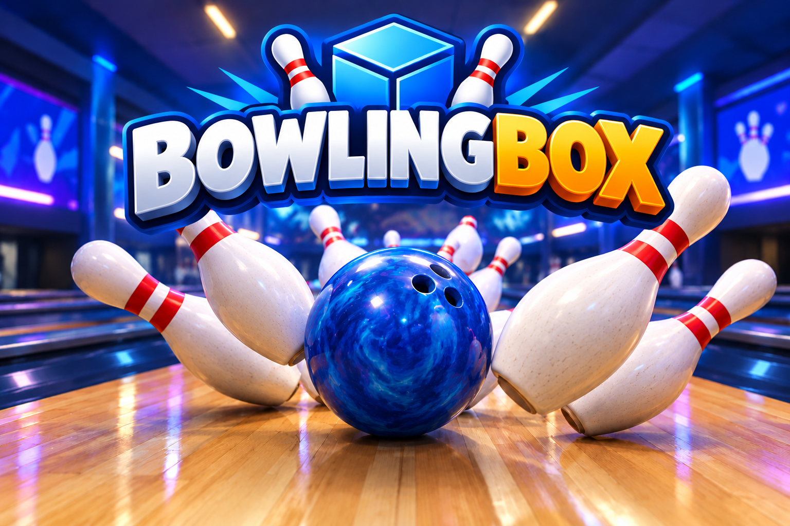
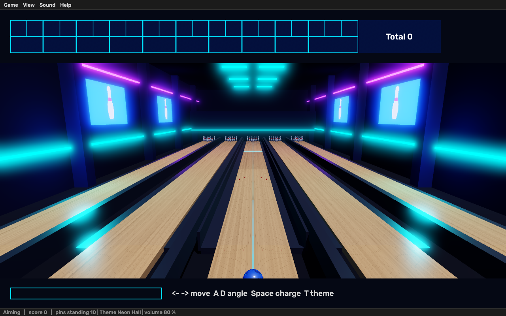

# Bowlingbox

[](https://github.com/medaminben/Bowlingbox_R/actions/workflows/ci.yml)
[](https://github.com/medaminben/Bowlingbox_R/releases/latest)
[](https://github.com/medaminben/Bowlingbox_R/releases)
[](https://medaminben.github.io/Bowlingbox_R/)


[](LICENSE)



Bowlingbox is a 3D ten-pin bowling game for Windows and Linux. You aim the ball, hold a key to charge
the throw and let go; a physics engine decides which pins fall. This is version 2, rewritten in Rust. Version 1 was
[Bowlingbox 1.5.5](https://github.com/medaminben/Bowlingbox), written in C++.

## Download

Get the installer for your system from the [latest release](https://github.com/medaminben/Bowlingbox_R/releases/latest):

| System | File |
| --- | --- |
| Windows | `Bowlingbox_Setup_<version>.exe` |
| Debian, Ubuntu | `bowlingbox_<version>_amd64.deb` |
| Other Linux | `Bowlingbox-<version>-x86_64.AppImage` |

If you have Bowlingbox 1.5.5 installed, uninstall it first.

## The game



- A 3D lane with a camera that follows the ball, in three themes: Neon Hall, Classic Alley and Outdoor.
  Shadows, lane reflection and bloom are on where the graphics card supports them.
- A full ten-frame game with the standard scoring, a scoreboard and a power bar.
- Sounds for the rolling ball, the pins, strikes and spares, and a background ambience for each
  theme. Mute, volume and ambience are remembered between runs.

## Controls

| Action | Keyboard | Mouse |
| --- | --- | --- |
| Move the ball | Left, Right | Move over the lane |
| Turn the aim | A, D | Drag with the right button |
| Throw | Hold Space, release to throw | Hold the left button, release to throw |
| New game | N, Ctrl+N | Game menu |
| Change the theme | T | View menu |
| Mute, volume | M, + and - | Sound menu |
| Background ambience | B | Sound menu |
| Quit | Esc, Ctrl+Q | Game menu |

The [user manual](https://medaminben.github.io/Bowlingbox_R/) explains the game, the scoring, the
settings and what to do when something goes wrong.

## Build from source

You need Rust (the version in `rust-toolchain.toml` is installed by `rustup` on the first build). On
Linux you also need the ALSA headers: `sudo apt install libasound2-dev`.

```
cargo run --release -p bowlingbox
cargo test
```

Command-line options:

| Option | What it does |
| --- | --- |
| `--theme=neon\|classic\|outdoor` | Starts with this theme |
| `--mute` | Starts without sound, for this session only |
| `--debug-view` | Draws the top-down physics view instead of the 3D view |
| `--screen=<name>` | Opens a named screen, for the manual's screenshots |
| `--version` | Prints the version |

Two environment variables help with graphics problems. `BOWLINGBOX_RENDER=basic` turns off shadows,
reflection and bloom. `BOWLINGBOX_RENDER_STATS=1` prints the GPU time of each render pass about once a
second. When the game falls back to the basic look or runs without sound, it prints one line on the
error output that says why.

`cargo bk` lists the build commands of [buildkit-rust](https://github.com/medaminben/buildkit-rust),
which this project uses for versions, the manual and the installers.

## Layout

<!-- bk:layout -->
| Path | Purpose |
| --- | --- |
| [`crates/score`](crates/score) | `bowlingbox-score`: the ten-pin scoring rules. |
| [`apps/bowlingbox`](apps/bowlingbox) | `bowlingbox`: the game. |
| [`crates/lane`](crates/lane) | `bowlingbox-lane`: the lane types, the physics trait and the throw state machine. |
| [`crates/render`](crates/render) | `bowlingbox-render`: themes, decor layout, meshes, lighting maths, camera, scene description and the wgpu scene renderer. |
| [`crates/audio`](crates/audio) | `bowlingbox-audio`: the 13 embedded sounds, the audio output trait, a kira output and a silent fallback. |

`cargo bk add-crate <name>` and `cargo bk add-app <name> --console|--gui` add a row to this table and to the one in [docs/ARCHITECTURE.md](docs/ARCHITECTURE.md). Your own text in either file is never rewritten.

## Documentation

- [User manual](https://medaminben.github.io/Bowlingbox_R/), also in
  [docs/manual](docs/manual/content/en/index.md) as Markdown.
- [Architecture](docs/ARCHITECTURE.md): how the game is built, for contributors.
- [Acceptance checklist](docs/ACCEPTANCE.md): what was tested for v2.0.0.
- [Changelog](CHANGELOG.md).

## License

MIT, see [LICENSE](LICENSE). The menu and HUD font is Rubik (SIL Open Font License); its licence is in
[packaging/NOTICES-extra.txt](packaging/NOTICES-extra.txt).
