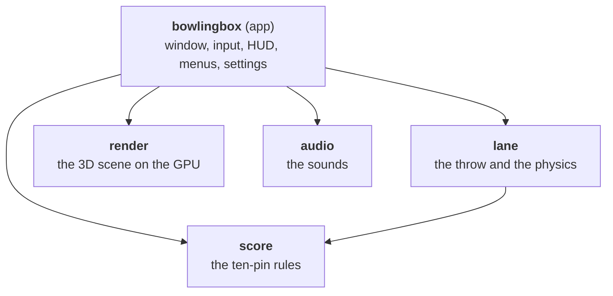

# Bowlingbox architecture

How Bowlingbox is built, for anyone who wants to read or change the code.

## The big picture

Bowlingbox is one program, `bowlingbox`, built from four libraries. The libraries hold the game's
logic and know nothing about windows: they can be tested without a screen, a graphics card or a sound
device. The app is the thin layer that connects them to a window, the keyboard and mouse, the GPU
and the speakers.

| Part | What it does | Built on |
| --- | --- | --- |
| `score` | Counts a game of ten frames: strikes, spares, the tenth frame, the totals | nothing |
| `lane` | Runs a throw from aiming to the last pin settling, and reports the pins knocked down | Rapier (physics) |
| `render` | Draws the lane, pins, ball and theme decor in 3D | wgpu (GPU) |
| `audio` | Plays the game's 13 sounds | kira (audio) |
| `bowlingbox` | The window: input, HUD, menus, dialogs, settings, and the glue between the libraries | eframe and egui |

Two rules keep the parts apart:

- **A library never depends on the app.** Only `lane` uses another library (`score`). `render` and
  `audio` know neither `lane` nor each other.
- **Only the app converts between the libraries' types.** A lane snapshot becomes a 3D scene in one
  place (`scene_adapter`), and becomes sound cues in another (`sound_director`).

## Layout

<!-- bk:layout -->
| Path | Purpose |
| --- | --- |
| [`crates/score`](crates/score) | `bowlingbox-score`: the ten-pin scoring rules. |
| [`apps/bowlingbox`](apps/bowlingbox) | `bowlingbox`: the game. |
| [`crates/lane`](crates/lane) | `bowlingbox-lane`: the lane types, the physics trait and the throw state machine. |
| [`crates/render`](crates/render) | `bowlingbox-render`: themes, decor layout, meshes, lighting maths, camera, scene description and the wgpu scene renderer. |
| [`crates/audio`](crates/audio) | `bowlingbox-audio`: the 13 embedded sounds, the audio output trait, a kira output and a silent fallback. |

Libraries live in `crates/` and hold the logic. Apps live in `apps/` and only wire a library to an interface: a command line or a window. An app depends on a library, never the other way round, so each library can be tested without an interface.

## One frame, step by step

eframe calls `App::ui` once per frame. In order, it:

1. **Reads the input.** `input` maps a key or mouse action to a `Command`, such as `MoveAim`,
   `StartCharge`, `Release` or `CycleTheme`. `command::route` decides whether the command may run:
   while the Controls or About window is open, Esc closes it and the game keys do nothing.
2. **Advances the game.** `fixed_step` turns the time since the last frame into whole physics steps
   of 1/60 s, so the game runs at the same speed at any frame rate. After a stall it runs at most five
   steps and drops the rest. `sound_control` steps the lane, collects the pin and ball impacts and
   hands them to the sound director, which plays the matching sounds.
3. **Moves the camera.** `follow_camera` keeps the camera behind the foul line while aiming, follows
   the rolling ball, and eases back afterwards.
4. **Draws the window.** The menu bar sits at the top and the status bar at the bottom. The middle
   holds the 3D view, with the scoreboard above it and the power bar, hint and throw result below.
   `view3d` hands the scene to the renderer through an egui paint callback.
5. **Sleeps when nothing moves.** While the game waits for a throw and the camera is home, the app
   stops requesting frames, and the window draws nothing until the next input.

## The score crate

`bowlingbox-score` has no dependencies. It exports:

- `Game`: a game that accepts rolls (`roll`, `reset`). `roll` refuses a bad roll with
  `RollError::GameOver` or `RollError::TooManyPins` instead of accepting it.
- `ScoreSheet`: read access to a game: `rolls`, `frame_totals`, `score`, `frame_score`, `pins_left`
  and `is_over`.
- `ScoreCalculator`: the implementation of both.
- `Slot`: what one roll position on the scoreboard shows (`NotPlayed`, `Empty`, `Strike`, `Spare`,
  `Pins(n)`). `notation` and `total_notation` turn slots and totals into scoreboard text.
- `frames` and `frames_of`: the game as ten `FrameView`s, ready for drawing a scoreboard.

The constants `FRAMES` (10), `PINS` (10) and `ROLL_SLOTS` (21) describe the sheet.

## The lane crate

`bowlingbox-lane` runs a throw. It depends on `bowlingbox-score` and on Rapier, and no Rapier type
leaves the crate.

`Lane` is the throw as a state machine. Its phase moves through `Aiming`, `Charging`, `Rolling`,
`Settling` and `FrameDone`, and ends in `GameOver` after the tenth frame. The commands `move_aim`,
`rotate_aim`, `start_charge`, `release` and `new_game` return `LaneError::WrongPhase` and change
nothing when the phase does not allow them. `step(dt)` advances the timers and the physics.
`snapshot` tells the rest of the program what the lane shows right now: the phase, the poses of the
ball and pins, the aim and the power.

The physics sits behind the `PhysicsWorld` trait, which knows no bowling rules. That keeps `Lane`
testable with a scripted fake world. The real one, `RapierWorld`, runs fixed sub-steps of 1/120 s,
at most four per `step` call. `Lane::default()` is the game: a `RapierWorld` and a `ScoreCalculator`.

The physics is tuned by hand, because Rapier does not reproduce the C++ game's Bullet numbers. The
constants `POCKET_OFFSET`, `POCKET_ANGLE_DEG` and `POCKET_POWER` describe a throw that usually strikes;
the tests and the manual both use them.

Impacts, which drive the sounds, are reported once per pair of bodies on their first touch. A pair
that stays in contact does not report again until the bodies separate. Contacts below 0.3 N·s are
dropped, and so are pin contacts before the ball nears the rack. The app must drain the impacts every
frame, because the buffer holds 256.

### Units and axes

- Units are metres, seconds and kilograms. Angles are in degrees where a name ends in `_deg`.
- The origin is on the foul line in the middle of the lane, with the lane surface at `y = 0`. +z runs
  down the lane towards the pins, +y is up and +x is the bowler's right.
- +x appears on the right of the screen, so the Right key moves the ball right. The `render` camera is
  left-handed (glam's `lh` look-at and perspective), which gives this with no conversion; a test
  covers it. The meshes keep the C++ winding, which appears clockwise on screen (`FrontFace::Cw`).
- Rotations are unit quaternions in the order (x, y, z, w).
- `Pose.position` is the rigid-body origin. For the ball that is its centre. For a pin it is the point
  on its axis 0.12 m (`LANE.pin_origin_height`) above its base, not its centre of mass. The renderer
  adds `PIN_MESH_OFFSET_Y` along the pin's own up axis to place the pin mesh.

## The render crate

`SceneRenderer` draws the scene that `scene_adapter` builds from a lane snapshot: the lane, the ball,
the pins, the decor of the current theme and, while aiming, a translucent aim guide. It ports the
C++ renderer and has two paths.

**The full path** adds shadows, the lane reflection and bloom. It runs four passes each frame:

1. **Shadow:** a 1024x4096 depth map seen from the key light.
2. **Reflection:** the scene mirrored in the lane, at half resolution, shown on the lane surface.
3. **Main:** the scene into a 16-bit floating-point (HDR) image with up to 4x multisampling. A depth
   pre-pass comes first, so the expensive lighting runs once per pixel.
4. **Post:** a four-level bloom around bright parts such as the neon strips, then ACES tone mapping
   with the theme's exposure into the final 8-bit image.

**The basic path** draws only the main pass and tone maps in the same shader. It stays within the
limits of older GPUs and of wgpu's GL backend.

The renderer picks the path when it starts. `Capabilities::probe` reads what the GPU offers, and
`choose_path` takes the basic path when:

- `BOWLINGBOX_RENDER=basic` is set;
- the GPU cannot render to and sample a 16-bit float image, or its largest texture is below 4096 px;
- a full-path pipeline fails to build;
- the full path's images fail to build at a new window size. The full path then stays off for the
  rest of the run.

The app prints the reason once on the error output, for example
`render: basic path (BOWLINGBOX_RENDER=basic)`.

On wgpu's GL backend the full path draws with one sample. wgpu-hal 30 cannot create a multisampled
image that a shader also reads on GL, so the probe reports one sample there.

The shaders are WGSL files in `crates/render/src/shaders`. The lit shader has a GGX key light,
hemisphere ambient light, up to four point lights, fog, emissive materials and the wood and ball
patterns.

### Details of the full path

- The main pass writes each colour as `c / (1 + max(c))`. The average of the samples is then the
  weighted resolve of the C++ game, which keeps the edges of neon strips and highlights smooth. The
  bloom and composite passes undo the weight. When the GPU cannot resolve 16-bit float images
  itself (`Capabilities::hdr_resolve`), a shader (`resolve.wgsl`) averages the weighted samples
  instead. A GPU test checks that both give the same image.
- The aim guide blends over the weighted scene, so its cyan is up to about 16 of 255 levels darker
  than in the C++ game. Drawing it after the resolve would fix that, at the cost of an extra pass and
  of multisampling on its edges.
- `FullPathOptions` turns the shadow, reflection and bloom passes off one by one, for debugging and
  tests. The app leaves all three on.

### Measuring the GPU time

`BOWLINGBOX_RENDER_STATS=1` times the four passes with GPU timestamp queries and prints the averages
about once a second, for example
`render: shadow 1.99 ms, reflection 0.37 ms, main 10.08 ms, post 4.01 ms (GPU, 31 frames)`. A pass
that did not run shows 0.00. The queries rotate through three sets, so a frame never waits for the
GPU. Without timestamp queries the app prints
`render stats: timestamp queries not supported by this adapter` once and runs without them.

On an Intel UHD (Comet Lake GT2), in a release build at 1920x1080 with the full path, Neon Hall runs at
71 frames/s (at least 63), Classic Alley at 72 and Outdoor at 90. Most of the remaining time goes to
the four point lights in the lit shader, about 2.9 ms per frame in Neon Hall.

### How the renderer fits into egui

The renderer runs inside an egui-wgpu paint callback. `prepare` draws the scene into the renderer's
own images, sized to the view, and returns a command buffer to submit before egui's pass. `paint`
then copies the result into egui's pass. That pass must have no depth attachment, which is eframe's
default. A view of size zero draws nothing.

## The audio crate

`bowlingbox-audio` embeds the 13 WAV files of the C++ game (`crates/audio/sounds/`; where each came
from is in `SOURCES.md`) and lists them in a catalogue (`SoundId`, with a loop flag).

`AudioOutput` is the interface the app plays through: `play`, `set_loop` for the three loop slots
(rolling, charging, ambience), mute and master volume. `KiraOutput` plays on the default sound device.
`SilentOutput` plays nothing. `open_output()` returns the kira output, or the silent one and the
message `sound disabled: <reason>` when no device opens. The game then runs without sound.

## The app

The app's modules fall into logic, which has unit tests, and drawing.

**Input and commands**

- `input` maps keys and mouse actions to commands; `lane_commands` applies them to the lane.
- `command::route` decides what a key does. An open dialog takes Esc first and blocks the game,
  theme and sound keys. Release always passes, so a throw never sticks while charging.
  `menu_click_allowed` applies the same rule to menu clicks. With no dialog open, Esc quits.

**HUD, menus and dialogs**

- `hud_text` holds every string the player reads: hints, phase names, `STRIKE!`, `SPARE!`, `Gutter`,
  the status line, the Controls text. `throw_result` is the one rule for what a throw was; the sound
  director uses it too.
- `hud_layout` splits the window: 18 % of the height on top for the scoreboard, 10 % at the bottom for
  the power bar, hint and result, the rest for the 3D view. `scoreboard` computes the cell text and the
  grid, and `hud` draws them. The geometry is computed again every frame, so everything rescales with
  the window.
- `menus` builds the menu bar (Game, View, Sound, Help) and `dialogs` the Controls and About windows.
  `menus::sound_menu` returns the checked and enabled states as a value, so they are tested without a
  window.
- `fonts` embeds Rubik Medium and makes it egui's main font.

**Sound**

- `sound_director` turns lane snapshots, the score sheet and the impacts into sound cues. Its tests
  use a recording output instead of a speaker.
- `sound_settings` holds mute, volume and ambience. `theme_sounds` picks the ambience of a theme.
- `sound_control` joins them. It applies the sound commands, steps the lane for the frame and drains
  the impacts every frame, also while muted, so that no backlog builds up.

**Settings**

`settings_store` saves `sound.muted`, `sound.volume` and `sound.ambience` through eframe's storage.
Each value falls back to its default on its own, and a volume outside 0 to 100 is clamped. `--mute`
mutes only the current session and is not saved. The theme is not saved, as in the C++ game. egui's
own memory, which includes the zoom, is not saved either.

**3D view and camera**

- `scene_adapter` is the one place that turns a lane snapshot into a `SceneDescription`.
- `follow_camera` ports the C++ camera: home behind the foul line, following the rolling ball,
  easing back. It reports when it is home, so the window can sleep.
- `view3d` keeps the renderer in egui-wgpu's callback resources and draws it in the central panel.

**Command line and screenshots**

- `cli` parses `--theme`, `--mute`, `--debug-view`, `--screen` and `--capture` with clap and collects
  the startup warnings, which `main` prints once.
- `screen` opens a named screen for the manual (`game`, `controls`, `about`, `sound-menu`,
  `theme-classic`, `theme-outdoor`): an open dialog, the Sound menu drawn open, or a theme.
- `capture` takes the manual's screenshots for `cargo bk manual capture`. After at least 10 frames,
  once the camera is home, it requests one screenshot, writes it to a temporary PNG and renames it to
  the requested path. A capture run plays no sound, saves nothing, and on any error prints
  `capture failed: <reason>` and exits with 1.

`app/acceptance.rs` holds the automated part of the acceptance checklist; see
[ACCEPTANCE.md](ACCEPTANCE.md).

## Dependencies

| Crate | Depends on |
| --- | --- |
| `bowlingbox-score` | nothing |
| `bowlingbox-lane` | `bowlingbox-score`, `rapier3d` |
| `bowlingbox-render` | `wgpu`, `glam`, `bytemuck` |
| `bowlingbox-audio` | `kira` (cpal backend only), `hound` |
| `bowlingbox` | the four crates above, `eframe`, `clap`, `glam`; `buildkit` at build time |

- `eframe` runs with the wgpu renderer and its default features off. Only `wgpu`, `default_fonts`,
  `wayland`, `x11`, `accesskit` and `persistence` are on. The app also names `winit` to switch on
  `wayland-csd-adwaita`, so GNOME on Wayland draws a title bar.
- The workspace pins `wgpu` to the version that eframe's `egui-wgpu` uses, so the build has one wgpu.
- `buildkit` supplies the version that `--version` and the About window show.
- On Linux, cpal needs the ALSA headers to build (`libasound2-dev`) and the ALSA library at run time,
  which desktop Linux systems have.
- The dev profile builds `rapier3d` and `parry3d` with `opt-level = 3`, so a debug build still
  simulates in real time.

## Decisions

- **Only the 3D game is ported.** The C++ console app, the score display app and the `Core` library
  stay in the C++ repository. Rust's `Result` replaces `Core`.
- **The scoring rules are their own crate.** They need no window, GPU or sound device, so they are
  tested without one.
- **eframe with our own wgpu renderer, not Bevy.** Bevy would save rendering code, but it would
  impose its architecture, slow the builds and break about every three months.
- **Rapier for physics, kira for sound.** The throw was tuned again for Rapier, because Rapier does not
  reproduce the C++ game's Bullet numbers.
- **A separate repository with a Beta branch.** Features merge into `Beta`, which releases
  `v2.0.0-beta.N`. Promoting `Beta` to `main` releases the stable version.
